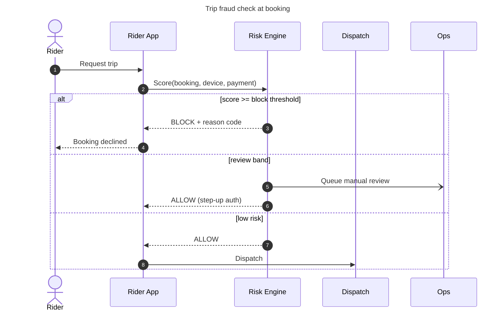

# Diagram Builder

Produce diagrams as **editable source first, rendered output second**. Source lives in git; renders are regenerated.

## 1. Pick the format

| Need | Format | Why |
|---|---|---|
| Sequence, state, class, ERD, flowchart, gantt, journey, timeline, mindmap | **Mermaid** (`.mmd`) | Text diff-able, renders in GitHub/Notion/Confluence |
| Free layout, swimlanes with many lanes, architecture with icons, anything stakeholders will hand-edit | **draw.io** (`.drawio`) | Pixel control, opens in diagrams.net / VS Code extension |
| C4 context/container | Mermaid `C4Context` for quick, draw.io for polished | |

Default to Mermaid unless layout control or hand-editing by non-technical people matters.

## 2. Content rules (PO/BA quality bar)

- **One question per diagram.** Title states it: "How does a rider dispute a fraud-flagged trip?"
- Name actors by **role**, not system internals: `Rider`, `Driver`, `Fleet Owner`, `Risk Engine`, `Payments`, `Ops Agent`.
- Sequence diagrams: number messages (`autonumber`), show **alt/opt/loop** for decision points, mark async with `-)`, and show the unhappy path at least once.
- State machines: every state has an exit; include terminal states explicitly.
- Max ~12 nodes / ~8 participants per diagram. Split otherwise and link.
- Use the domain vocabulary of the topic you are diagramming (check the topic glossary if one exists).

## 3. Mermaid conventions



- Put a `title` in front-matter. Keep IDs short, labels human.
- Use `classDef` for at most 3 semantic colours (e.g. risk=red, system=grey, human=blue). Never decorate for its own sake.

## 4. draw.io conventions

- Write uncompressed XML (`<mxfile><diagram><mxGraphModel>…`) so diffs are readable.
- Use swimlane containers for lanes; snap to a 10px grid; consistent 120×60 boxes.
- One page per view (e.g. `As-is`, `To-be`) inside the same file.

## 5. Render

Try in order, use the first available:

1. **Mermaid CLI**: `npx -y @mermaid-js/mermaid-cli -i in.mmd -o out.svg` (needs Node).
2. **draw.io desktop CLI**: `draw.io -x -f svg -o out.svg in.drawio` (Windows: `"C:\Program Files\draw.io\draw.io.exe"`).
3. **Zero-install fallback**: write `<name>.html` next to the source that loads Mermaid from CDN and renders it — open in any browser:

```html
<!doctype html><meta charset="utf-8"><title>DIAGRAM TITLE</title>
<script type="module">import mermaid from "https://cdn.jsdelivr.net/npm/mermaid@11.4.1/dist/mermaid.esm.min.mjs";mermaid.initialize({startOnLoad:true,theme:"neutral"});</script>
<pre class="mermaid">
...diagram source...
</pre>
```

For draw.io without the desktop app, link `https://app.diagrams.net/` and tell the user to File → Open the `.drawio` file.

## 6. Where files go

Follow `AGENTS.md`: diagrams live in an `assets/diagrams/` folder inside the doc, presentation or prototype they belong to. Name: `<kebab-topic>.<type>.mmd|drawio` e.g. `booking-fraud-check.sequence.mmd`, with the render beside it (`.svg`).

## 7. Checklist before handing over

- [ ] Title answers one question
- [ ] Unhappy / exception path shown
- [ ] Actors are roles, terms match the glossary
- [ ] Source + render both saved, render is up to date
